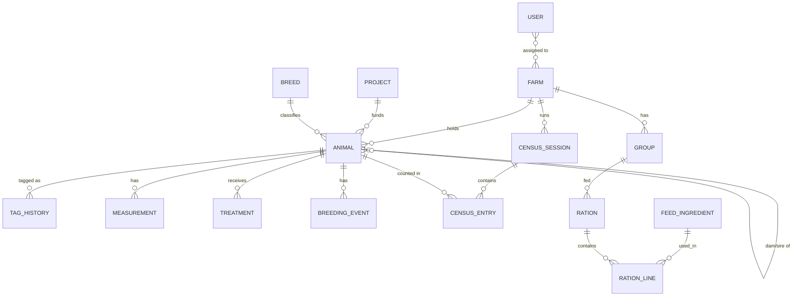

# User Requirements Specification (URS) — Draft v0.1

**System:** FELCRA Cattle Breeding Data Profiling System
**Client:** FELCRA Food Industries Sdn. Bhd. (FFISB) / FELCRA Berhad
**Reference system:** MARDI DSF (FFISB Breeder Data Profiling)
**Status:** Draft for review with HQ, farm managers and field officers. Items marked **[TBC]** need client confirmation (see §10).

Sources: `Document/KERTAS_1.PPT` (proposal paper), `Document/QTN-26-08-002 - FELCRA.pdf` (quotation),
`Document/V3.DATA PROFILING FB POGOH 2026.pdf` (Pagoh census & profiling report, 2–7 July 2026).

---

## 1. Purpose and scope

Breeding records (weight, BCS, fertility, health, treatments) are currently kept manually and separately at each
farm, reach HQ slowly, and are hard to verify or analyse. The system digitises recording at the pen and gives HQ a
real-time, auditable view of every farm.

In scope:
- **Admin web portal** (HQ and farm managers): dashboards, farm & user management, master data, reports (PDF/Excel).
- **Field app** (field officers): installable PWA for Android & iOS with QR ear-tag scanning and offline recording.
- **API & central PostgreSQL database**, analytics engine (Gompertz growth, Ali-Schaeffer lactation, least-cost ration),
  audit trail, notifications.

Out of scope (initial release): native app-store apps, financial/sales accounting, integration with external
government systems.

## 2. Users and roles

| Role | Who | App | Data visibility |
|---|---|---|---|
| **HQ Admin** (`HqAdmin`) | Veterinary / livestock HQ officers | Admin portal | All farms |
| **Farm Manager** (`FarmManager`) | Farm / project managers, PIC | Admin portal + field app | Assigned farms only |
| **Field Officer** (`FieldOfficer`) | Officers working at the pen | Field app | Assigned farms only |

### 2.1 Permission matrix

| Capability | HQ Admin | Farm Manager | Field Officer |
|---|:-:|:-:|:-:|
| Manage users, roles, farm assignments | ✔ | – | – |
| Manage master data (breeds, projects, treatments, feeds, model parameters) | ✔ | view | – |
| Manage farms & groups/pens | ✔ | own farms (groups) | – |
| Register / edit animals | ✔ | ✔ | ✔ (create, limited edit) |
| Record weight, BCS, milk, treatments, breeding events | ✔ | ✔ | ✔ |
| Run census sessions & mark animals "selected" | ✔ | ✔ | record only |
| Approve culling / status changes (sold, dead, culled) | ✔ | ✔ | – |
| Resolve sync conflicts | ✔ | ✔ | – |
| Dashboards & reports | all farms | own farms | own daily tasks |
| View audit log | ✔ | own farms | – |

## 3. Business workflow (pen → dashboard)

1. **Scan** — the officer scans the QR code on the ear tag (or searches by tag number).
2. **Record** — weight, BCS, milk, treatments and breeding events are entered in the app; works offline.
3. **Sync** — records upload automatically when a connection is available; analytics are recomputed.
4. **Monitor & act** — managers and HQ review dashboards, reports, reminders and culling candidates.

### 3.1 Census / headcount programme (as run at Pagoh, July 2026)

1. Create a census session: farm, project(s), dates, PIC, programme treatments
   (e.g. Brucella blood screening, FMD booster, Doramectin, multivitamin, tagging).
2. Record the **population on record** by category (bull / dam / male calf / female calf).
3. For each animal: tag no., category, estimated age (dentition), weight, BCS, project, remarks; tag untagged animals.
4. Mark animals that meet the programme specification as **selected**.
5. Compare counted vs on-record population; produce the census report and recommendations.

## 4. Functional requirements

IDs are referenced by test cases during UAT. Priority: **M** = must (go-live), **S** = should, **C** = could.

### 4.1 Authentication & access (FR-AUTH)
| ID | Requirement | Pri |
|---|---|---|
| FR-AUTH-01 | Users sign in with email + password; accounts lock for 15 min after 5 failed attempts. | M |
| FR-AUTH-02 | Field app stays signed in for up to 30 days so it can be used offline. | M |
| FR-AUTH-03 | Farm managers and field officers only see data for their assigned farms. | M |
| FR-AUTH-04 | HQ admin can create, deactivate users and assign roles/farms. | M |

### 4.2 Farm & master data (FR-MD)
| ID | Requirement | Pri |
|---|---|---|
| FR-MD-01 | Maintain farms/premises: code, name, address, state, area (ha), grazing capacity. | M |
| FR-MD-02 | Maintain projects/schemes (e.g. EPP5, RP4; RMK reference) and link farms to them. | M |
| FR-MD-03 | Maintain groups/pens per farm. | M |
| FR-MD-04 | Maintain breeds (e.g. Brahman Cross, Australian Cattle Cross). | M |
| FR-MD-05 | Maintain medicines, vaccines and treatment types (incl. withdrawal period). | M |
| FR-MD-06 | Maintain feed ingredients with nutrient composition and price. | S |
| FR-MD-07 | Maintain analytics model parameters and reminder rules. | S |

### 4.3 Animal registry (FR-ANI)
| ID | Requirement | Pri |
|---|---|---|
| FR-ANI-01 | Every animal has a system ID independent of its ear-tag number. | M |
| FR-ANI-02 | Tag numbers may repeat or be missing; the system warns on duplicates within a farm and keeps tag history. | M |
| FR-ANI-03 | Record sex, category (bull / dam / male calf / female calf), breed, farm, project, group, dam & sire (if known). | M |
| FR-ANI-04 | Record birth date as actual or **estimated** (method: dentition / records / owner). | M |
| FR-ANI-05 | Status lifecycle: active → sold / dead / culled / transferred, with date and reason. | M |
| FR-ANI-06 | Category changes over time (e.g. female calf → dam) are kept as history. | S |
| FR-ANI-07 | Generate printable QR labels for ear tags. | M |
| FR-ANI-08 | Import animals from Excel (template based on the census form) with an error report. | M |

### 4.4 Performance recording (FR-REC)
| ID | Requirement | Pri |
|---|---|---|
| FR-REC-01 | Record body weight (kg) with date and method (scale / tape). | M |
| FR-REC-02 | Record Body Condition Score (scale **[TBC]**). | M |
| FR-REC-03 | Record milk yield per milking/day. | S |
| FR-REC-04 | Record treatments & vaccinations (product, dose, route, batch, next due date). | M |
| FR-REC-05 | Record health observations (legs/hooves, physical structure, remarks) and photos. | S |
| FR-REC-06 | All recording works offline and syncs automatically (FR-SYNC). | M |

### 4.5 Fertility & breeding (FR-BRD)
| ID | Requirement | Pri |
|---|---|---|
| FR-BRD-01 | Record heat, natural service (bull) and artificial insemination. | M |
| FR-BRD-02 | Record pregnancy checks with result and gestation age; compute expected calving date. | M |
| FR-BRD-03 | Record calving (auto-register calf), abortion, dystocia. | M |
| FR-BRD-04 | Record bull Breeding Soundness Examination (BSE). | S |
| FR-BRD-05 | Compute calving interval, days open, pregnancy and calving rates. | M |
| FR-BRD-06 | Flag culling candidates (e.g. dam not pregnant in 12–18 months, age ≥ 8 years, poor health) — rules configurable. | M |

### 4.6 Census programme (FR-CEN)
| ID | Requirement | Pri |
|---|---|---|
| FR-CEN-01 | Create census sessions with farm, dates, PIC and programme treatments. | M |
| FR-CEN-02 | Capture per-animal census entries (weight, estimated age, remarks, selected flag). | M |
| FR-CEN-03 | Show population on record vs counted, by category. | M |
| FR-CEN-04 | Generate the census & profiling report in the current FFISB layout. | M |

### 4.7 Analytics (FR-ANL)
| ID | Requirement | Pri |
|---|---|---|
| FR-ANL-01 | Gompertz growth curve per animal/group; flag animals below expected weight. | M |
| FR-ANL-02 | Ali-Schaeffer lactation curve; expected lactation yield (dairy farms only **[TBC]**). | S |
| FR-ANL-03 | Least-cost ration per group and production target using feed ingredient data. | M |

### 4.8 Reminders & notifications (FR-NOT)
| ID | Requirement | Pri |
|---|---|---|
| FR-NOT-01 | Reminders for vaccination due, pregnancy checks, expected calving, low BCS. | M |
| FR-NOT-02 | Daily task list in the field app; push notifications where supported. | S |

### 4.9 Dashboards & reports (FR-RPT)
| ID | Requirement | Pri |
|---|---|---|
| FR-RPT-01 | HQ dashboard: population by category, average weight/BCS, pregnancy & calving rates, mortality — per farm/project with trends. | M |
| FR-RPT-02 | Reports in PDF and Excel: census, selected animals, health/treatments, farm performance, culling candidates. | M |
| FR-RPT-03 | Scheduled monthly reports emailed to managers/HQ. | C |

### 4.10 Offline & sync (FR-SYNC)
| ID | Requirement | Pri |
|---|---|---|
| FR-SYNC-01 | The field app caches the officer's farm animals and can record without a connection. | M |
| FR-SYNC-02 | Unsynced record count is always visible; sync runs automatically when online. | M |
| FR-SYNC-03 | Measurements never overwrite each other; profile edit conflicts are flagged for manager review. | M |

### 4.11 Audit (FR-AUD)
| ID | Requirement | Pri |
|---|---|---|
| FR-AUD-01 | Every create/update/delete stores who, when and old/new values. | M |
| FR-AUD-02 | Records are soft-deleted (recoverable by HQ). | M |

## 5. Data dictionary (core entities)

Derived from the FFISB census form ("Borang Bancian dan Profiling Data") and the proposal paper.

### Farm
| Field | Type | Notes |
|---|---|---|
| Code | text(32), unique | e.g. `PAGOH` |
| Name | text | e.g. FELCRA Berhad Kawasan Pagoh |
| Address, State | text | |
| AreaHectares | decimal | Pagoh: 319 ha |
| Capacity | int | Planned grazing capacity, Pagoh: 200 head |

### Project / Scheme
| Field | Type | Notes |
|---|---|---|
| Code | text | `EPP5` (Entry Point Project 5), `RP4` (Rolling Plan 4) |
| Name, Plan reference | text | e.g. RMK-11 |

### Animal
| Field | Type | Notes |
|---|---|---|
| AnimalId | UUID | System identity; encoded in the QR label |
| TagNo | text, nullable | Current ear tag; may be missing or duplicated (e.g. `08478`, `A13 2340`) |
| Sex | M / F | |
| Category | Bull (P) / Dam (I) / Male calf (AJ) / Female calf (AB) | Census-form codes in brackets |
| Breed | ref | |
| BirthDate | date | With `BirthDateIsEstimated` and `EstimationMethod` (dentition / record) |
| FarmId, ProjectId, GroupId | ref | |
| DamId, SireId | ref, nullable | |
| Status | Active / Sold / Dead / Culled / Transferred | With date & reason |

### Measurement (append-only)
| Field | Type | Notes |
|---|---|---|
| AnimalId, Date, RecordedBy | | |
| Type | Weight / BCS / Milk | |
| Value, Unit | decimal | kg, score, litres |

### Treatment (append-only)
Animal, date, product, dose, route, batch no., next due date, programme (census session), officer.

### Breeding event (append-only)
Animal, date, type (Heat / AI / Natural service / Pregnancy check / Calving / Abortion / BSE), result,
bull or semen ref, gestation age, calf ref.

### Census session & entry
Session: farm, project(s), start/end date, PIC, programme treatments, population on record by category.
Entry: session, animal, weight, estimated age, BCS, remarks, `Selected` (yes/no).

### Feed ingredient & ration
Ingredient: name, DM %, CP %, TDN/ME, Ca, P, price per kg. Ration: group, target, ingredient quantities, cost/day.

## 6. Entity relationship overview

## 7. Screen list (wireframe scope)

**Admin portal:** Sign in · Dashboard · Farms (list/detail) · Projects · Groups · Breeds · Treatments & vaccines ·
Feed ingredients · Users & roles · Animals (list/filter, profile with timeline & growth chart) · Animal import ·
QR label printing · Census sessions (list, entry grid, summary) · Breeding & culling candidates · Ration planner ·
Reports · Audit log · Settings.

**Field app:** Sign in · Home (today's tasks, unsynced count) · Scan QR · Find animal · Animal profile ·
Record weight / BCS / milk · Record treatment · Record breeding event · Register new animal / calf ·
Census mode (fast sequential entry) · Ration view · Sync status.

## 8. Non-functional requirements

| ID | Requirement |
|---|---|
| NFR-01 | Field app usable on mid-range Android phones and iPhones (iOS 16.4+), one-handed, large touch targets. |
| NFR-02 | Field app fully usable offline for at least 7 days of recording. |
| NFR-03 | Admin pages load in < 3 s on a typical office connection; field scan-to-profile < 1 s from cache. |
| NFR-04 | HTTPS everywhere; passwords hashed; tokens short-lived; role- and farm-based access enforced by the API. |
| NFR-05 | Daily database backups kept 30 days, with an offsite copy; restore tested before go-live. |
| NFR-06 | Audit trail retained for at least 7 years **[TBC]**. |
| NFR-07 | UI in English, structured for adding Bahasa Melayu later. |
| NFR-08 | Personal data handled in line with PDPA 2010. |

## 9. Assumptions

- One central deployment (Linux VPS, Docker, PostgreSQL) serves all farms.
- Field officers have a smartphone with a camera; connectivity at pens may be absent for days.
- Existing Pagoh census data (140 head) is the pilot dataset.
- Ages in historical data are estimates from dentition.

## 10. Open questions for FELCRA

1. Which BCS scale is used — 1–5 or 1–9?
2. Are there dairy farms? (Pagoh cattle are beef; the Ali-Schaeffer milk model may only apply elsewhere.)
3. Existing ear-tag format — can QR stickers be added to current tags, or are new tags needed?
4. Source of feed nutrient & price tables (MARDI?).
5. Exact criteria for "selected" animals, to be turned into system rules.
6. Initial number of users and farms (server sizing).
7. Is a Bahasa Melayu UI needed for field officers at launch?
8. Audit/record retention period required by FELCRA policy.
9. The Pagoh report's summary table (P 11 / I 61 / AJ 28 / AB 40) does not match its own animal list, which adds up to
   P 13 / I 60 / AJ 31 / AB 36. Which is correct? (The system counts from the animal list.)
10. Line 17 (tag 175) is recorded as a male calf (AJ) aged 3 years — should it be a bull?
11. Tags 107, 08478, 135 and 136 are each used by two animals, and 8 animals are untagged. Re-tagging them before the
    next census lets the system match animals automatically.
12. Monthly report e-mail: FELCRA's SMTP server (host, port, account) and sender address, and whether anyone besides
    HQ admins and farm managers should receive it.
13. Reports are in English (the original census form is in Malay). Is a Malay version of the census form needed for
    submission to FFISB / FELCRA?
14. Hosting: which VPS provider and size, the domain names (production and staging), who operates the server
    day to day, where off-site backups should go, and the IT contact for alerts and security reports.

## 11. Approval

| Role | Name | Signature | Date |
|---|---|---|---|
| Prepared by (developer) | | | |
| Reviewed by (FFISB veterinary) | | | |
| Approved by (FELCRA HQ) | | | |
