# Farm manager guide

As a farm manager you use the **admin portal** on a computer (`https://<your-domain>/admin/`) for your assigned
farms, and you can also use the **field app** at the pen (see the [field officer guide](field-officer.md)).
HQ administrators see the same screens for all farms, plus the set-up screens in the [HQ guide](hq-admin.md).

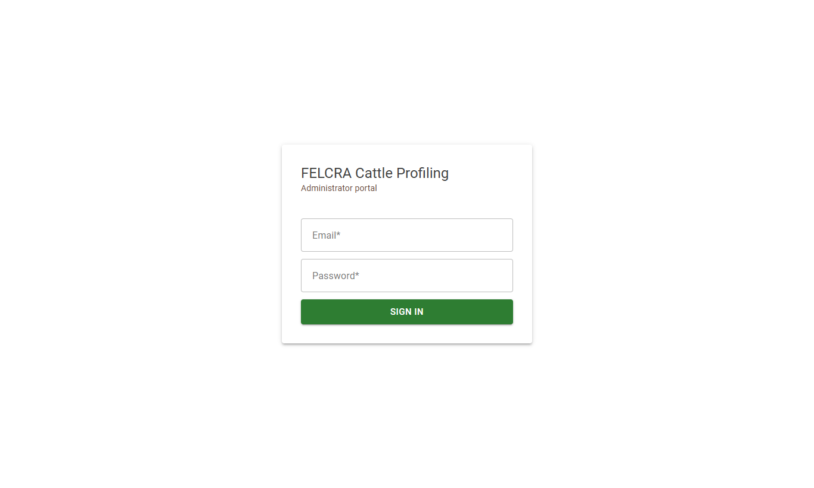

Sign in with your e-mail and password. Your name at the top right opens **Change password**; the icon next to it
signs out. The menu on the left lists the screens below.

## 1. Dashboard

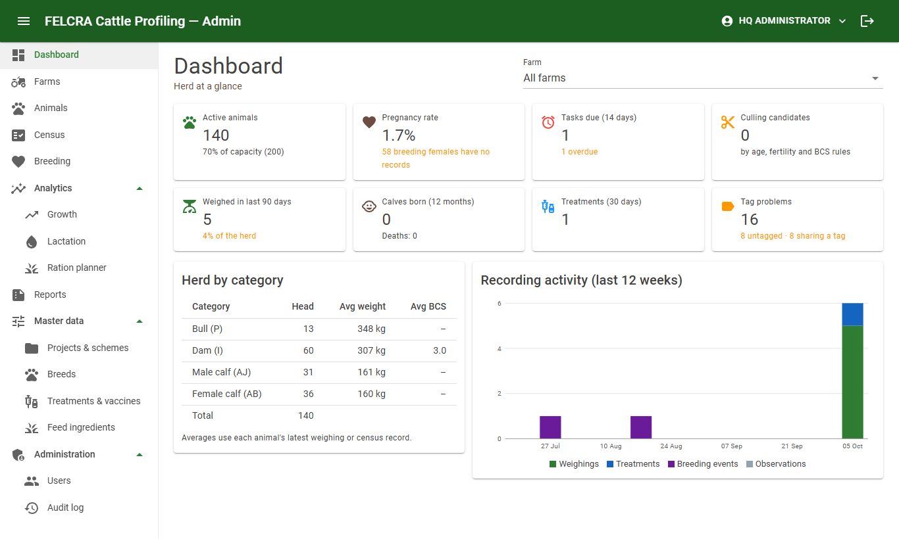

The herd at a glance; choose a farm at the top right (or all your farms). Click a card to go to its details.

| Card | Meaning |
|---|---|
| Active animals | Head count, and % of the farm's capacity |
| Pregnancy rate | Pregnant breeding females ÷ all breeding females. Shown as "–" until breeding is recorded |
| Tasks due (14 days) | Pregnancy checks, calvings and treatments due; red when some are overdue |
| Culling candidates | Animals meeting the culling rules (section 5) |
| Weighed in last 90 days | Animals with a recent weight — aim to weigh every animal at least every 3 months |
| Calves born (12 months) | With deaths and the mortality % in the last 12 months |
| Treatments (30 days) | Treatments recorded recently |
| Tag problems | Untagged animals and tag numbers used twice — fix these before the next census |

Below: the herd by category with average weight and BCS, and how many records were made each week.

## 2. Animals

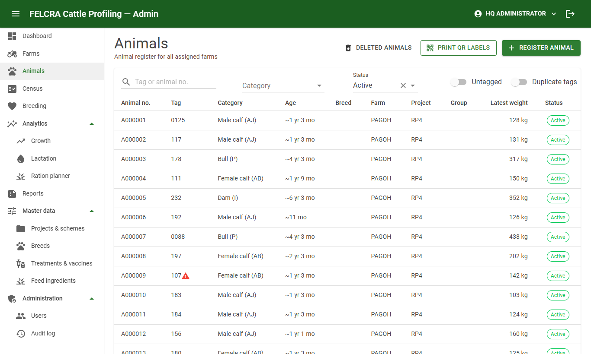

- Search by tag or animal no.; filter by farm, category, status. **Untagged** and **Duplicate tags** show the
  animals that need a new tag.
- **Register animal** adds one by hand (calves born at the farm are added automatically from the calving record).
- **Print QR labels** prints labels for the animals in the current list (or one animal from its page).

Click an animal to open it:

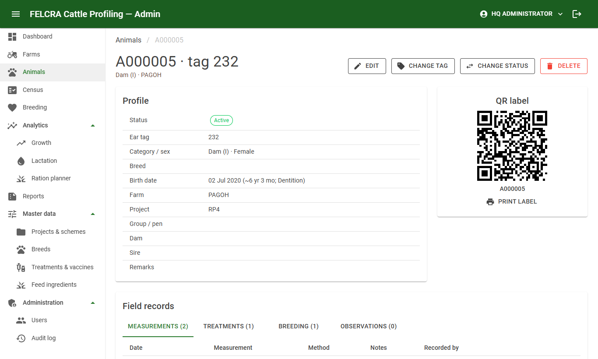

| Button | Use |
|---|---|
| **Edit** | Category, breed, birth date (actual or estimated and how), project, group/pen, dam and sire, remarks |
| **Change tag** | A lost or duplicate tag was replaced. The old number stays in the tag history |
| **Change status** | Sold, dead, culled or transferred — with the date and reason. The animal leaves the active herd |
| **Delete** (HQ) | Only for animals entered by mistake. HQ can restore them |

The **Field records** tab shows weights, BCS, treatments, observations and photos; **Breeding** shows the dam's
events, status, expected calving and offspring.

**QR labels:** print on sticker sheets (A4), cut out and attach to the ear tag. Scanning a label always opens the
right animal, even when tag numbers are duplicated.

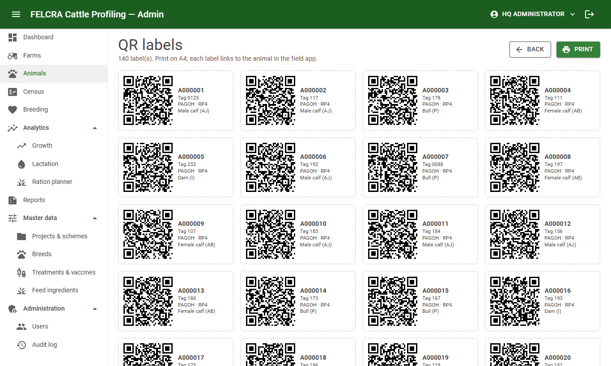

## 3. Census programme

The census reproduces the FFISB *Census and data profiling form*.

1. **Census → New session**: farm, title (e.g. *Headcount & health programme, July 2026*), dates, person in charge,
   the **population on record** per category (P / I / AJ / AB) and the programme treatments.
2. Add the animals counted, either:
   - **Import sheet** — an Excel or CSV file in the paper-form layout (BIL., NO.TAG, P, I, AJ, AB, UMUR, BERAT,
     CATATAN, or the English template from **Download template**). The preview shows what will happen to each
     row and any errors (e.g. a tag used twice) before anything is saved. Turn on **Match existing animals by tag**
     for a farm whose animals are already registered.
   - **Add animal** — one entry at a time.
3. For each entry: category at census, weight, estimated age, BCS, remarks, **Selected for the programme**.
4. The page compares **on record** with **counted** per category.
5. **Reports → Census and profiling form (PDF)** prints the form in the Pagoh layout (summary, farm box, animal list
   with selected animals highlighted, sign-off box). **Census sheet (Excel)** can be corrected and imported again.
6. When finished, **Edit session → Closed** so it cannot be changed by mistake.

Put the findings and recommendations in the session's **Notes**: they are printed in the report.

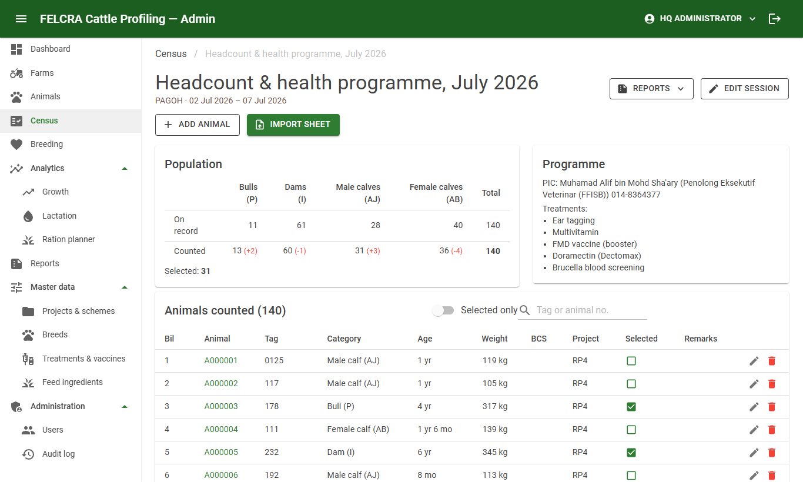

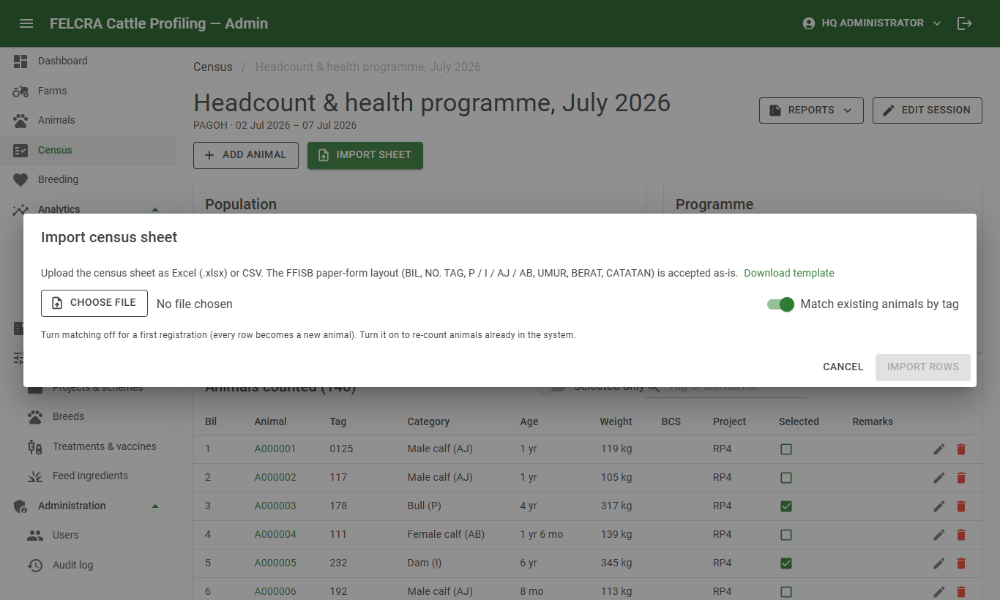

## 4. Breeding

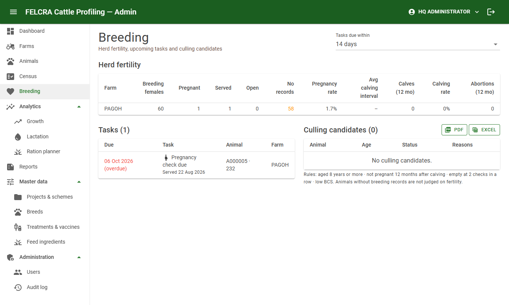

- **Herd fertility** per farm: breeding females, pregnant / served / open, no records, pregnancy rate, average
  calving interval, calves and calving rate, abortions.
- **Tasks**: pregnancy checks (45 days after service), expected calvings, treatments due, low BCS. Choose how far
  ahead (7–60 days). Field officers see the same tasks on their phones.
- **Culling candidates**: dams aged 8 years or more, not pregnant 12 months after calving, empty at 2 pregnancy
  checks in a row, or with low BCS. Download as PDF or Excel. The list is advice — confirm with a veterinary check
  and record the decision with **Change status → Culled**.

Females with no breeding records are not judged on fertility. Record pregnancy checks for all dams to get reliable
figures.

## 5. Analytics

**Growth** — a Gompertz growth curve for females and for males, fitted to all weights of animals with a birth
date. The table lists animals 15% or more below the curve for their age (from 3 months old) — check their feed and
health.

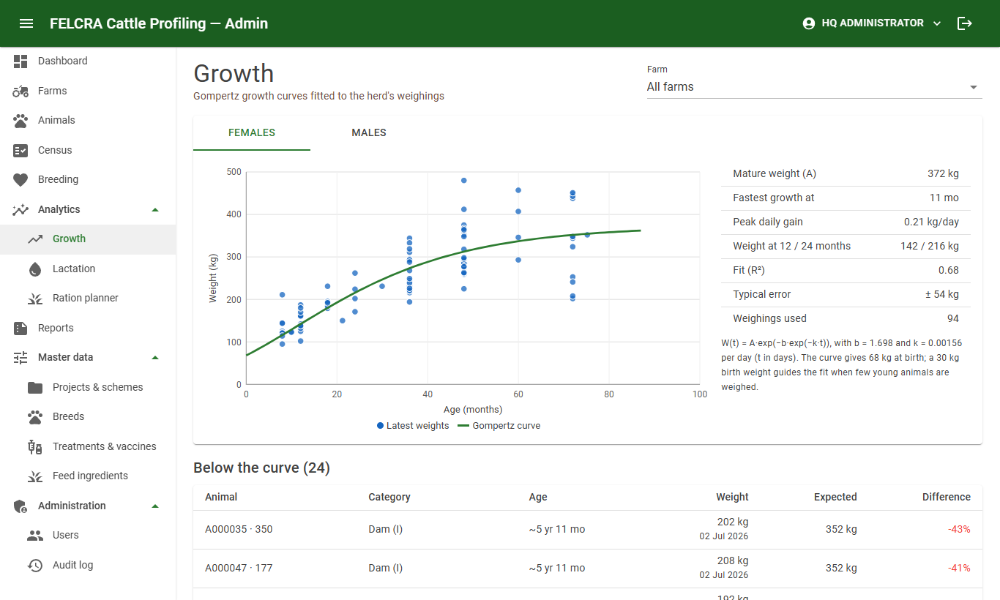

**Lactation** — milk curves from daily milk yields (dairy dams only). Shows a message when no milk is recorded.

**Ration planner** — the cheapest daily feed mix for an animal class from the feed ingredients and prices in
Master data. Untick feeds you do not have; set a maximum % for a feed if needed.

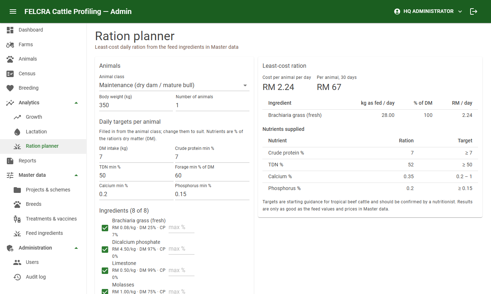

## 6. Reports

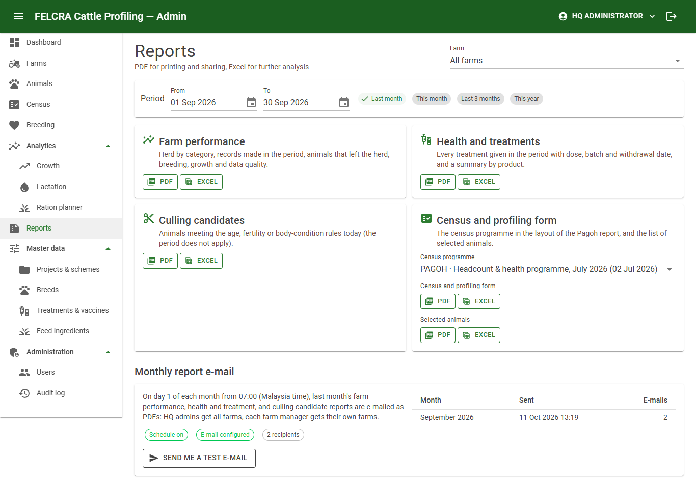

Choose the farm and period (or *Last month*, *This month*, *Last 3 months*, *This year*), then **PDF** (to print or
share) or **Excel** (to analyse):

| Report | Contents |
|---|---|
| Farm performance | Herd today, records made in the period, animals that left the herd, breeding, growth, data quality |
| Health and treatments | Every treatment in the period with dose, batch and withdrawal date; summary by product |
| Culling candidates | As on the Breeding page |
| Census and profiling form / Selected animals | For a census programme |

On the 1st of each month you receive last month's farm performance, treatment and culling reports by e-mail (when
FELCRA has switched it on).

## 7. At the pen

Use the field app on your phone for recording ([field officer guide](field-officer.md)). Status changes (sold, dead,
culled) and corrections to an animal's details are made in the admin portal.

## Problems and answers

| Problem | What to do |
|---|---|
| A number on the dashboard looks wrong | Check the farm selected at the top right. Figures use the latest weight or census record of each animal |
| "This record was changed by someone else" | Another user saved it first. Reload the page and make your change again |
| Import shows errors | Fix the rows listed (e.g. two animals with one tag, missing category) in the sheet and try again; nothing is saved until all rows are valid |
| An animal is missing | Check the status filter (sold / dead animals are hidden by default). If it was deleted, ask HQ to restore it |
| The pregnancy rate is "–" | No breeding records yet on that farm |
