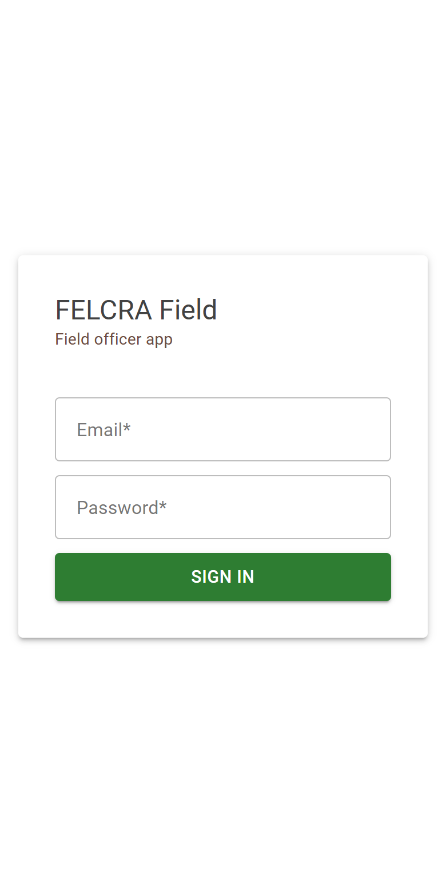
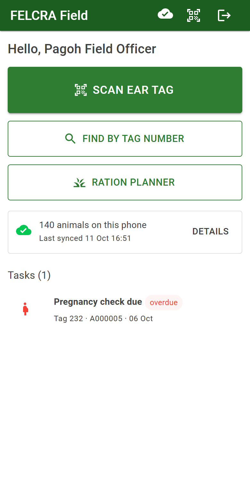
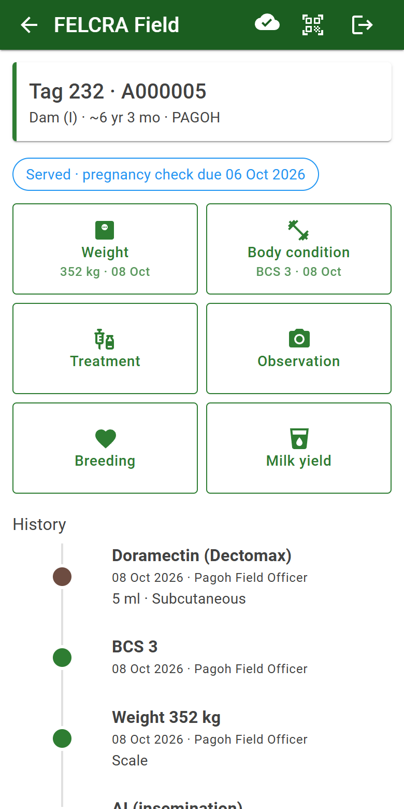
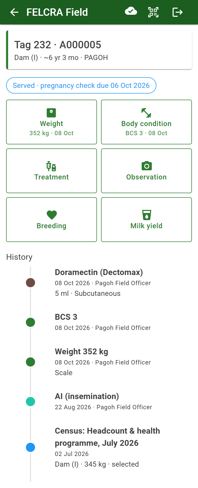
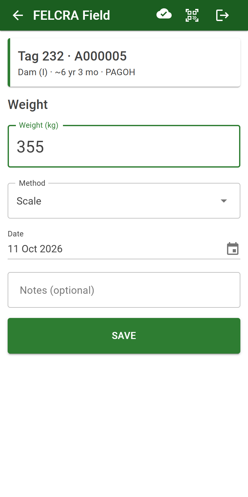
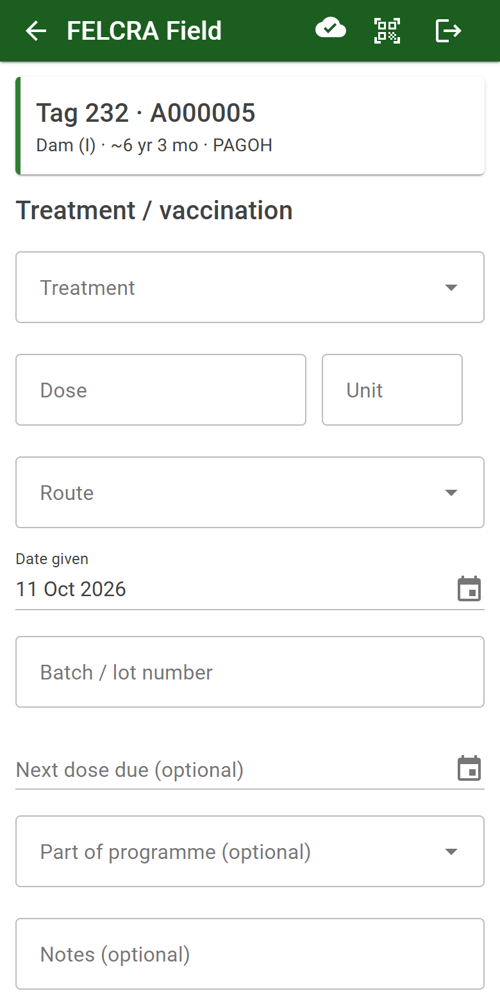
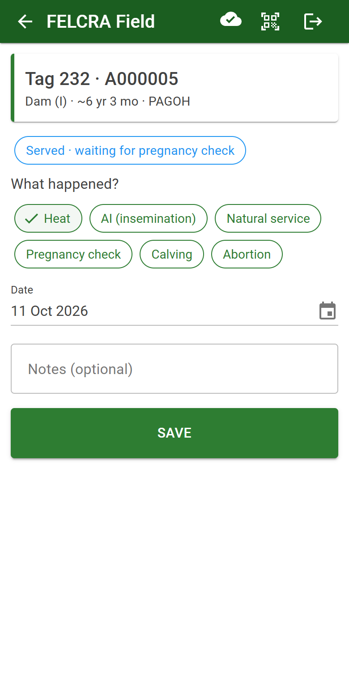
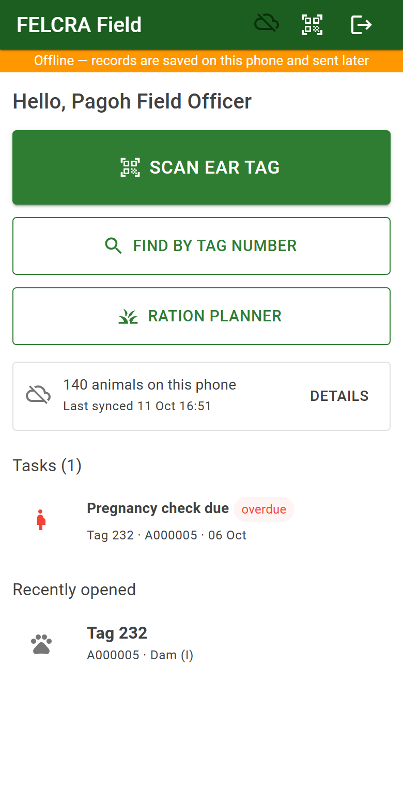
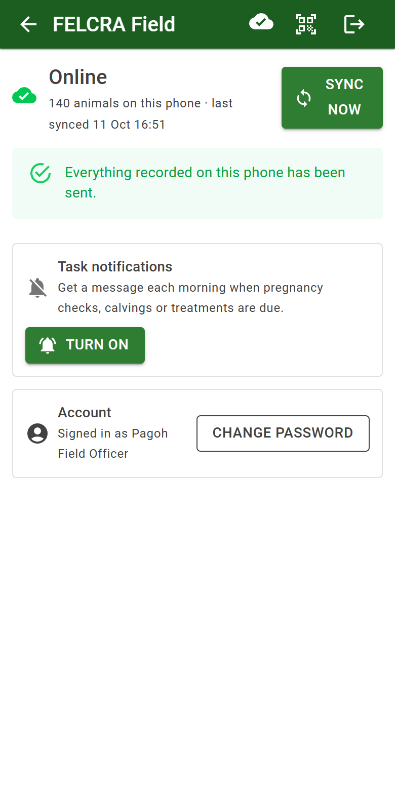
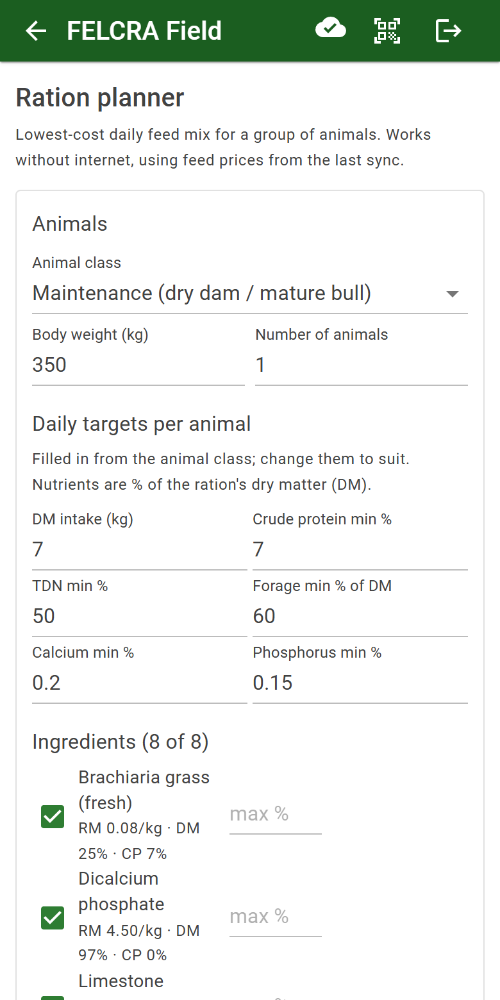

# Field officer guide

The field app runs on your phone. You use it at the pen to find an animal and record what you see and do.
It works **without internet**: records are kept on the phone and sent when there is a connection.

## 1. Install the app (once)

You need the address from your manager, e.g. `https://profiling.felcra.com.my/field/`.

**Android (Chrome)**
1. Open the address in **Chrome**.
2. Tap **⋮ → Add to Home screen → Install**.
3. Open *FELCRA Field* from the home screen from now on.

**iPhone (Safari, iOS 16.4 or later)**
1. Open the address in **Safari**.
2. Tap **Share (□↑) → Add to Home Screen → Add**.
3. Open *FELCRA Field* from the home screen from now on (needed for notifications).

## 2. Sign in

Enter the e-mail and password from your manager and tap **Sign in**. The first time, the app downloads your farm's
animals; wait until the home screen shows **"140 animals on this phone"** (your farm's number). Do this where
there is internet. You stay signed in for up to 30 days, even offline.

## 3. Home screen

- **Scan ear tag** — open an animal by its QR label.
- **Find by tag number** — when there is no label or the camera cannot read it.
- **Ration planner** — work out a feed mix (section 8).
- The box below shows how many animals are on the phone, when it last synced, and records **waiting to send**.
- **Tasks** — pregnancy checks, calvings and treatments due soon (red = overdue). Tap one to open the animal.
- **Recently opened** — animals you opened lately.

Top bar: the cloud shows the sync state (tap it for the **Sync** screen), the QR icon opens the scanner, the last
icon signs out.

## 4. Find an animal

**Scan:** tap **Scan ear tag**, allow the camera the first time, and hold the QR label in the frame. The animal
opens by itself.

**By tag number:** tap **Find by tag number** and type the tag (or animal no.).

If two animals share a tag number, both are listed — check the category and age to choose the right one, and tell
your manager so one can be re-tagged. Untagged animals can be found by animal no. (e.g. A000135).

## 5. The animal page

The top shows tag, animal no., category, age (~ means estimated) and farm. Below it, the breeding status (for
dams), the buttons to record, and the **History** of everything recorded for this animal, newest first.

## 6. Record

Tap a button on the animal page, fill in, tap **Save**. The date is today unless you change it. You will see
*"… saved."* — or, without internet, *"… saved on this phone — it will be sent when you are back online"*.

| Button | What to enter |
|---|---|
| **Weight** | Weight in kg and how it was measured (scale, heart-girth tape, visual estimate). |
| **Body condition** | BCS score. |
| **Milk yield** | Litres for the day (milking dams only). |
| **Treatment** | Product (vaccine, deworming, vitamin, test…), dose, route, batch no., next due date. The withdrawal date is worked out from the product. |
| **Observation** | What you saw (legs/hooves, physical structure, illness, injury, behaviour, general) — and photos. |
| **Breeding** | See below. |

 

If a value is unusual (e.g. 2000 kg), the app tells you and does not save it.

### Breeding events

Choose the event:

| Event | Notes |
|---|---|
| **Heat** | Signs of heat seen. |
| **AI (insemination)** | Semen / straw code. A pregnancy check task appears 45 days later. |
| **Natural service** | Choose the bull. |
| **Pregnancy check** | Pregnant / empty / uncertain, and the gestation age if known. The expected calving date is worked out. |
| **Calving** | One line per calf: sex, ear tag if tagged, birth weight. **Each calf is registered as a new animal.** Tick *Assisted calving* for a difficult birth. |
| **Abortion** | Date and notes. |
| **Bull soundness exam** | For bulls: result of the BSE. |

## 7. Working without internet

 

- An orange bar says **Offline**. Keep working: find animals, record everything as usual.
- Records are sent automatically when the phone is online again. You can also tap **Sync now** on the **Sync** screen.
- The **Sync** screen lists records still on the phone. *Waiting to send* is normal while offline.
- **Not accepted** means the server refused a record — for example the animal was sold meanwhile. Read the reason;
  tap **↻ Retry** if it was fixed, or the bin to discard it.
- Do not sign out or clear the browser data while records are waiting — they would be lost. The app warns you.

## 8. Ration planner

Choose the animal class (maintenance, late pregnancy / lactating, growing, finishing), body weight and number of
animals. The app picks the cheapest mix of the ticked feeds that meets the targets and shows kg per animal per day
and the cost. Untick a feed you do not have; set *max %* to limit one. Works offline with the prices from the last
sync. The targets are a guide — follow your veterinarian's advice.

## 9. Task notifications

On the **Sync** screen, **Task notifications → Turn on**, then allow notifications. Each morning you get one message
when pregnancy checks, calvings or treatments are due on your farm. Tap it to open the app. **Send a test** checks it
works. On iPhone it only works when the app was added to the Home Screen (section 1).

## 10. Password and shared phones

- **Change password:** **Sync** screen → **Account → Change password**. Your other phones are signed out.
- **Shared phone:** always **sign out** (top-right icon) when you finish. Signing out removes your farm data and
  notifications from the phone. Sync first — the app warns you if records have not been sent.
- Lost phone: tell your manager at once so HQ can block your account.

## Problems and answers

| Problem | What to do |
|---|---|
| "Connect to the internet once to download…" | First sign-in needs internet. Go where there is signal and wait for the animal count. |
| The camera does not start | Allow the camera for the site (browser settings → site permissions). Use **Find by tag number** meanwhile. |
| The QR label does not scan | Clean the label, hold the phone 15–25 cm away in good light. Or find by tag number. |
| "This animal is not on any of your farms" | The QR label belongs to an animal on another farm. Check the tag; tell your manager. |
| A new animal from HQ is not on the phone | Tap **Sync now** on the Sync screen. |
| Records stay *waiting to send* | Check the phone has internet; tap **Sync now**. If they stay, contact support — do not sign out. |
| Forgot password | Ask your manager / HQ to reset it. After 5 wrong tries the account is locked for 15 minutes. |
