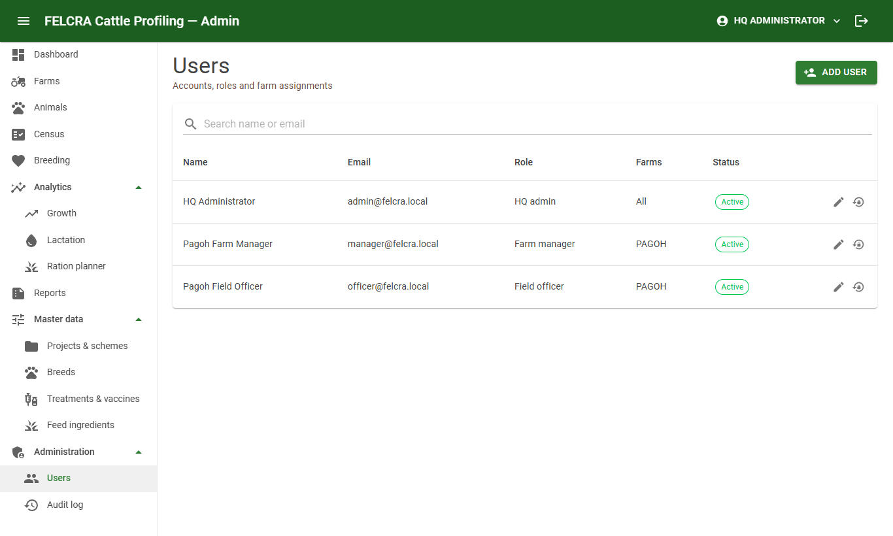
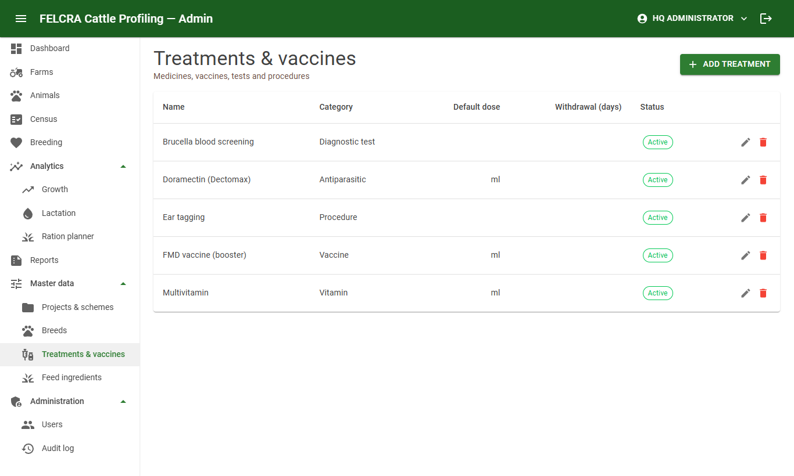
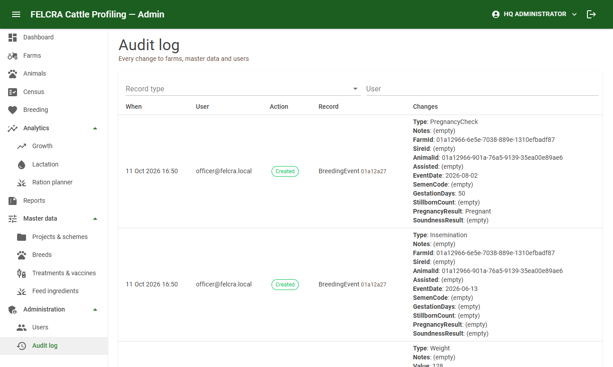

# HQ administrator guide

HQ administrators see every farm and set the system up. Everything in the [farm manager guide](farm-manager.md)
applies to you too; this guide covers the extra screens under **Master data** and **Administration**.

## 1. Setting up a new farm (checklist)

1. **Master data → Projects & schemes**: the schemes the farm belongs to (e.g. EPP5, RP4).
2. **Farms → Add farm**: code (short, e.g. `PAGOH`), name, address, state (from the list), area (ha), grazing capacity,
   projects, and the **latitude / longitude** so the farm shows on the Malaysia map (in Google Maps, right-click the
   farm and click the numbers to copy them).
   Open the farm to add **groups / pens** if animals are kept in groups.
3. **Administration → Users → Add user** for the farm manager and field officers, with the farm assigned.
4. Register the animals — usually by importing the census sheet (farm manager guide, section 3).
5. Print QR labels for the ear tags.

## 2. Users

| Action | How |
|---|---|
| Add a user | **Add user**: full name, e-mail (used to sign in), role, farms, initial password. Give the password to the person privately; they change it under their name → **Change password** |
| Roles | **HQ admin** — all farms, all set-up. **Farm manager** — admin portal and field app for their farms. **Field officer** — field app only, for their farms |
| Move someone to another farm / role | ✎ **Edit** → farms / role. They are signed out so the change applies at once |
| Forgotten password or locked out | 🔒 **Reset password**. This also unlocks the account (5 wrong passwords lock it for 15 minutes) |
| Someone leaves, or a phone is lost | ✎ **Edit** → untick **Active (can sign in)**. They are signed out everywhere. Their records stay |

Passwords need at least 8 characters with an upper-case letter, a lower-case letter and a digit.

## 3. Master data

| List | Notes |
|---|---|
| Projects & schemes | Code, name, plan reference (e.g. RMK-11) |
| Breeds | Code and name (e.g. BX — Brahman Cross) |
| Treatments & vaccines | Category, default dose and unit, **meat withdrawal period (days)** — used to show until when a treated animal must not be sold for meat |
| Feed ingredients | Dry matter, crude protein, TDN, ME, calcium, phosphorus (% of dry matter) and price per kg as fed — used by the ration planner. Replace the sample values with analysed values and current prices |

To stop using an item, untick **Active**: it disappears from the choices for new records but old records keep it.
Delete only items entered by mistake.

## 4. Audit log

Every change is recorded: who, when, the record, and old → new values. Filter by record type or user. Actions are
*Created*, *Updated*, *Deleted* and *Restored*.

## 5. Restoring a deleted animal

**Animals → Deleted animals** lists animals deleted from the register, with who deleted them and when.
**Restore** brings one back together with its records and its census entries. Only HQ can delete and restore.
For animals that were sold, died or were culled, use **Change status** instead of deleting — they then stay in
the reports.

## 6. Monthly report e-mail

**Reports → Monthly report e-mail** shows whether the monthly e-mail is on, the number of recipients, and the months
already sent. HQ admins receive all farms; each farm manager receives their own farms. **Send me a test e-mail**
sends last month's reports to you only — use it after any change to the mail settings.

## 7. Settings changed by IT

Some rules are server settings (changed by the system administrator, see `docs/DEPLOYMENT.md`), not screens:

| Setting | Default |
|---|---|
| Gestation length for expected calving | 285 days |
| Pregnancy check after service | 45 days |
| Culling: not pregnant after calving / age / empty checks in a row | 365 days / 8 years / 2 |
| Low BCS flag | below 2.0 (1–5 scale) |
| Monthly e-mail day and time | 1st of the month, 07:00 |
| Daily task notification time | 07:00 |
| Sign-in: access token / staying signed in | 15 minutes / 30 days |

Agree changes with the veterinary team and ask IT to apply them; they take effect after a restart.
